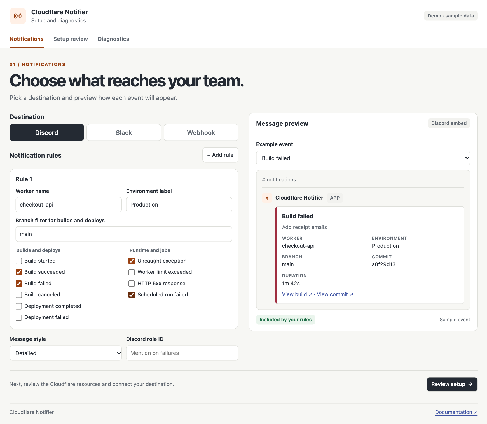
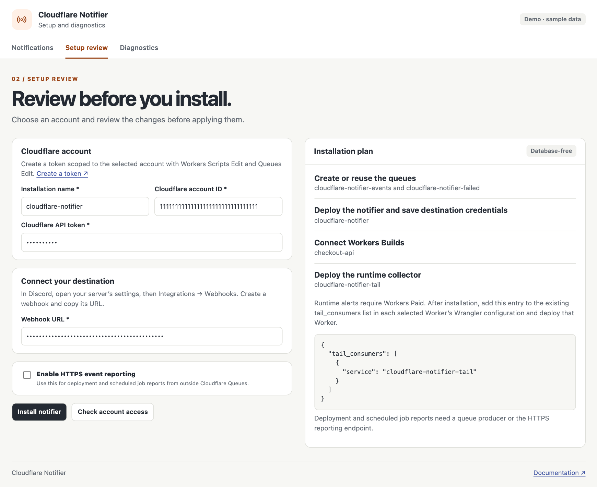

# Cloudflare Notifier

Send Cloudflare build, deployment, and runtime alerts to **Discord**, **Slack**, or an **HTTPS webhook**. Preview your messages in the local setup app, review what will change in Cloudflare, and send a test to your channel.

The notifier runs in your Cloudflare account with a Worker and two queues. It installs directly from your machine and works without a database or a GitHub connection.



## Try the demo

You’ll need [Node.js 22.18 or newer](https://nodejs.org/). The demo uses sample data and runs on your machine.

```sh
git clone https://github.com/notice-cx/cloudflare-notifier.git
cd cloudflare-notifier
npm ci
npm run setup -- --demo
```

Pick a destination and an example event to see how the message changes. You can also try setup review, installation, and diagnostics in the demo.

## Install in your Cloudflare account

1. **Create a destination webhook.** In Discord, open **Server Settings → Integrations → Webhooks** and copy the webhook URL. In Slack, enable [Incoming Webhooks](https://docs.slack.dev/messaging/sending-messages-using-incoming-webhooks/) for your app and pick a channel. For a custom endpoint, have its HTTPS URL and any required headers ready.
2. **Prepare Cloudflare access.** Copy your [account ID](https://developers.cloudflare.com/fundamentals/account/find-account-and-zone-ids/) and [create an API token](https://developers.cloudflare.com/fundamentals/api/get-started/create-token/) scoped to that account with **Workers Scripts Edit** and **Queues Edit**.
3. **Open setup.** If you skipped the demo, clone the repo and run `npm ci` as shown above. From the repo directory, run the command below and open the printed address if your browser doesn’t open automatically.

   ```sh
   npm run setup
   ```

4. **Choose what to send.** Enter the exact name of an existing Worker, choose events, and preview the result. Add rules to watch more Workers. For builds and deployments, a blank branch field matches every branch. Use an environment label that makes sense to your team.
5. **Review and install.** Enter the account ID, token, and destination URL. Select **Check account access** to check the account and resource names, then **Install notifier** to apply the plan.
6. **Verify your destination.** Open **Diagnostics → Send test message**, then look for **Test notification** in your channel or endpoint.



You can close the setup app after installation. Cloudflare keeps delivering events. To edit or resume an installation, run setup again from the same directory and enter the credentials for that installation. For a second destination, use a different installation name. Open it again with `npm run setup -- --name YOUR_INSTALLATION`.

## What can I send?

| Events | How they get to the notifier |
| --- | --- |
| Build started, succeeded, failed, or canceled | Workers Builds sends events automatically once you install. |
| Deployment succeeded or failed | Your deployment pipeline sends the result after its deployment command runs. |
| Uncaught exceptions, Worker limit failures, or HTTP 5xx | A Tail Worker collects matching errors from selected Workers. Requires Workers Paid or Enterprise. |
| Scheduled job failure | Your scheduled handler reports a failure with the job name and schedule. |

Use **Detailed** for commit, duration, and other available context. **Compact** keeps the core information and links. Discord supports a role mention on failures. Set the webhook’s sender name and avatar in Discord or Slack.

### Deployment results and preview links

Choose **Deployment completed** or **Deployment failed** in a rule and enable **HTTPS event reporting** during setup. Save the endpoint from Diagnostics as `NOTIFIER_REPORT_URL` and the reporting token as `NOTIFIER_REPORT_TOKEN` in your CI settings.

After a successful deployment, report the version ID returned by Wrangler and the actual deployment or preview URL. For automation, Wrangler can write its deployment receipt to [an NDJSON output file](https://developers.cloudflare.com/workers/wrangler/system-environment-variables/#wrangler_output_file_path).

```sh
npm run report -- deployment.succeeded checkout-api --branch main --deployment-id "$VERSION_ID" --url "$DEPLOYMENT_URL"
```

Report a failed deployment with `deployment.failed` and a short `--summary`. Build success messages link to the build. The **Deployment completed** event comes from the pipeline’s confirmed result.

### Runtime alerts

Select the runtime events you want, then install. Copy the `tail_consumers` entry from **Setup review** into each selected Worker’s Wrangler config and redeploy that Worker. Keep any existing tail consumers. **Diagnostics** shows whether the collector is connected. [Cloudflare Tail Workers guide](https://developers.cloudflare.com/workers/observability/logs/tail-workers/)

The collector forwards the error category and Worker name. It leaves request headers, URLs, and console output in Cloudflare. Start with the Worker and failure types you care about. Each matching invocation can send a notification.

### Scheduled jobs

Select **Scheduled run failed** and add a queue producer binding named `NOTIFIER_EVENTS` to your scheduled Worker. Point it at the event queue named in **Setup review**. Use [the scheduled handler example](examples/scheduled.ts) to wrap your job:

```ts
await reportScheduledFailure(env.NOTIFIER_EVENTS, controller, "billing-worker", "Sync invoices", () => syncInvoices(env));
```

For a job running outside Cloudflare, use the reporting endpoint and the `scheduled.failed` event with `--job` and `--schedule`. This reports runs that start and fail. A job that never starts needs a heartbeat monitor.

### Custom webhooks

The default POST body includes `schemaVersion`, `deliveryId`, `type`, `title`, and any available Worker, branch, environment, details, and links. The **Webhook** preview shows a sample. Use **HTTP headers** in Setup review for credentials such as an Authorization header.

If the destination needs a different JSON shape, enter a **Custom JSON body**. Replace a full string value with `{{fieldName}}` to insert that field, or use `{{event}}` for the complete event.

```json
{
  "text": "{{title}}",
  "event": "{{event}}",
  "id": "{{deliveryId}}"
}
```

## When a message doesn’t arrive

| What you see | What to check |
| --- | --- |
| Setup can’t access Cloudflare | Confirm the account ID and that the token has edit access to Workers Scripts and Queues in that account. |
| Test works but builds are quiet | Check that the Worker uses Workers Builds and that your rule includes the event and branch. Open the event queue’s subscriptions in Cloudflare. |
| Runtime alerts are quiet | Confirm the selected Worker includes the Tail Worker in its deployed configuration. Check **Diagnostics** for the connection. |
| A destination returns 401, 403, or 404 | Replace the webhook URL or credentials in Setup, reinstall with the same name, and send a new test. |
| A destination is slow or rate limited | Check the notification Worker’s logs for retry status. The notifier backs off on temporary failures and honors `Retry-After`. |

Messages that exhaust retries or receive a permanent rejection go to the failed-delivery queue. Inspect them before the queue’s retention period expires. To replay one, submit the original event body to the event queue. For permanent rejections, the original body is under `event` in the failure record. Cloudflare Queues may occasionally deliver a message more than once.

## Terminal setup

Copy [the example configuration](examples/notifier.json) to `notifier.local.json` and fill in your account and Worker. Provide `CLOUDFLARE_API_TOKEN` and `NOTIFIER_WEBHOOK_URL` through your shell or CI secret store. For custom webhooks, set `NOTIFIER_WEBHOOK_HEADERS` and `NOTIFIER_WEBHOOK_BODY` as JSON when needed. For HTTPS reporting, set `NOTIFIER_REPORT_TOKEN`.

```sh
npm run plan
node setup/cli.mjs check
npm run install:notifier -- --apply
node setup/cli.mjs test --apply
```

The plan runs offline. **Check** reads the selected Cloudflare account. The last two commands deploy resources and enqueue a test, respectively. Settings are stored under `.notifier/` for reuse. Webhook credentials are stored as Cloudflare Worker secrets.

## Remove an installation

Remove its Tail Worker from any monitored Worker’s Wrangler config and redeploy those Workers. In Cloudflare, remove the installation’s event subscriptions and delete the notifier and Tail Worker. Review any retained messages, then delete the two queues named in Setup review. Revoke the installer token if you no longer use it.

## Develop locally

```sh
npm ci
npm run check
npm test
npm run setup -- --demo
```

Tests use fixtures and local endpoints. The notification Worker reads the event queue, applies the first matching rule, and sends the selected format. Retries and failed deliveries use Cloudflare Queues.
